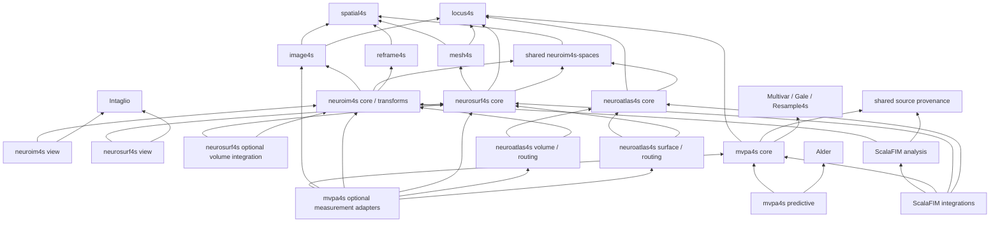

# Ecosystem unification and ScalaFIM modularization

Status: implementation started; U0 ownership decisions recorded in
[the deletion map](ecosystem-ownership.md).

Date: 2026-10-16.

Inspected ScalaFIM baseline: `86b3acf1e64d762be99b52ae146fa115b9050356`.
The checkout was clean before this document was added. No implementation,
compilation, numerical qualification, or publication is claimed by this plan.

## 1. Outcome

Make ScalaFIM a focused functional-neuroimaging analysis system built on a
coherent set of independently usable libraries. A concept has one authoritative
representation, one owner of its invariants, and explicit adapters at domain
boundaries. Moving data between libraries preserves its identity, ordering,
geometry, provenance, and ownership without rebuilding equivalent containers.

The four required extractions are:

- `neuroim4s`: neuroimaging volume/series refinements, anatomical world-space
  declarations, toolkit transform interpretation, neuroimaging IO policy, and
  optional volume visualization, composed over the core providers.
- `neuroatlas4s`: atlas identities, anatomical labels and hierarchies, catalogs,
  volume/surface realizations, queries, loaders, and atlas-specific mapping policy.
- `mvpa4s`: identified multivariate evidence, predictive and relational analysis,
  pattern methods, measurement composition, and reusable execution contracts.
- `neurosurf4s`: neuro-surface semantics, formats, sampling and resampling,
  reference surfaces, and visualization, built on `mesh4s`.

ScalaFIM retains HRF/design/model/fit/group inference, functional datasets and
response interpretation, fMRI workflows, and the adapters that connect their
results to those libraries. Atlas implementation leaves ScalaFIM. The current
mixed `spatial` module is split by ownership; only functional-analysis and
latent-response composition stays downstream.

These are committed extraction destinations, including separate repositories.
Internal modules remain useful for optional capabilities and platform boundaries.
The extraction order follows dependency readiness, not four simultaneous moves.

Success is measured by fewer competing concepts and cleaner dependency paths.
The number of repositories or sbt projects is not itself a target. Preserve
useful platform and optional-feature boundaries; combine modules only when
their dependencies and release responsibilities actually coincide.

## 2. Governing decisions and scope

This program extends the [native image decision](../decisions/native-image-data-model.md)
and [image unification plan](image-module-unification-hardening.md). It preserves
the scientific contracts of the [unified MVPA constitution](unified-mvpa-migration-ledger.md)
and the separation of response, representation, archive, and dataset in the
[response architecture](response-representation-archive-architecture.md).

The [spatial-transform ADR](../decisions/spatial-transforms.md) currently keeps
frame authority in image4s and mesh kernels in ScalaFIM for its own delivery
scope. Its sections 1 and 4 must be explicitly amended when the corresponding
provider migrations below are admitted. Historical receipts remain evidence
for their original revisions; a new plan does not retroactively change them.

Implementation rules:

1. Move generic capabilities to an appropriate provider and migrate the real
   consumer in the same delivery sequence. A new public abstraction needs a
   demonstrated use and an explicit invariant. Apply this test before relocating
   code: can image4s, locus4s, spatial4s, mesh4s, reframe4s, Gale, Ravel, graph4s,
   Multivar, Alder, or Intaglio already express the capability? If so, use it
   directly. Extend that owner when a required generic capability is missing.
2. Provider cores and the extracted libraries have no dependency on ScalaFIM,
   including test-source dependencies. Integration tests can depend on both.
3. Preserve distinct meanings: persistent identity, runtime ownership, exact
   correspondence, coordinate frame, numerical value identity, source lineage,
   access history, and statistical independence are separate contracts.
4. Public Scala source compatibility is secondary to a coherent pre-1.0 API.
   Migrate known callers and remove replaced APIs at each cutover. Temporary
   private adapters name their callers and expire at the next acceptance gate.
5. Persisted schemas, digests, domain keys, and published scientific results
   have a separate compatibility policy. Package renaming must not silently
   rename wire tags, recompute identities, reorder data, or reinterpret results.
6. Preserve primitive-array access, bounded materialization, scoped reads, and
   allocation discipline. An identity-safe API must still support hot kernels
   without per-element wrappers or copying whole images and meshes.
7. Keep scientific feature work separate from this migration. Existing gaps,
   caveats, adverse evidence, and experimental status follow their code.
8. A higher-level type must add an enforceable domain invariant or domain policy.
   Renaming, wrapping, or re-exporting a core type is not by itself a new
   abstraction. Keep values in provider representations across library boundaries.
   Do not move every generic helper into a new domain repository merely because
   that is where its callers moved.

This program does not require extracting every ScalaFIM module. Distributed
execution, new numerical methods, a universal data object, and a new archive
format are outside its initial scope. Publication and release remain separate
actions from implementation and verification.

## 3. Target ownership

| Concern | Owner | Boundary |
| --- | --- | --- |
| Dense arrays, rank, strides, immutable views, builders | Ravel | No anatomical identity or analysis policy. |
| Matrices, operators, solvers, decompositions, generic numerical kernels | Gale | Domain methods consume capabilities; they do not grow local solver families. |
| Finite domains, indices, regions, selections, maps, fields, quotient/neighborhood structure | locus4s | Geometry and statistical meaning remain downstream. |
| Coordinate dimensions, frames, points/vectors, units, conventions, frame alignment | spatial4s | image4s and mesh4s share these exact types. |
| Grids, sampled images, non-spatial sampling axes, image metadata/value semantics, image IO/operations | image4s | Surface topology and fMRI modeling remain downstream. |
| Triangulated topology, coordinate realizations, intrinsic metrics, generic mesh kernels | mesh4s | Neuroanatomy, GIFTI/FreeSurfer policy, and display remain downstream. |
| Transform algebra, directional map capabilities, resampling and registration kernels | reframe4s | No dependency on neuroim4s anatomical declarations or other domain libraries. |
| Graph representation and graph algorithms | graph4s | No mandatory scientific workflow runtime. |
| General multivariate semantic algebra and numerical methods | Multivar | MVPA-specific evidence designs and interpretations live in mvpa4s. |
| Ordinal resampling designs, draws, permutations, deterministic random streams | Resample4s | Scientific axis binding remains with the consumer. |
| Predictive fitting, preparation, validation, tuning, fitted artifacts | Alder | mvpa4s supplies domain models and evidence adapters. |
| Source/operation provenance | Optional locus4s-provenance | Shared by response and mvpa4s; no numerical or storage dependencies. |
| Shared anatomical world declarations and subject/template identities | Independently usable `neuroim4s-spaces` module | Hosted in neuroim4s; no volume/image runtime, surface, atlas or ScalaFIM dependency. Generic frame/identity machinery stays in core providers. |
| Neuroimaging volume/series refinements, toolkit interpretation, volume policy and display | neuroim4s | Consumes core providers and shared anatomical declarations; no dependency on neurosurf4s, neuroatlas4s, mvpa4s, or ScalaFIM. |
| Neuro-surface semantics, anatomical metadata, IO, projection, display | neurosurf4s | Core consumes mesh4s/locus4s/spatial4s and shared declarations; optional volume adapters consume neuroim4s. No mandatory volume stack. |
| Atlas catalogs, anatomical labels/hierarchies, realized assignments, queries and atlas-specific routes | neuroatlas4s | Core composes locus4s and shared declarations; optional volume/surface adapters consume their respective libraries. No new generic parcellation or registry algebra. |
| MVPA axes/evidence, measurement plans, relational/predictive/pattern analyses | mvpa4s | Core is independent of image, surface, dataset, and fMRI-fit APIs. |
| Renderer-neutral graphics primitives and reusable backend capabilities | Intaglio | Neuro-specific scene semantics remain in the relevant display library. |
| BIDS and generic storage-format mechanics | bids4s and zarr4s | ScalaFIM owns functional-analysis and archive profiles. |
| fMRI interpretation, models, estimation, inference, dataset/workflow composition | ScalaFIM | Optional adapters depend on the independent libraries. |

The diagram shows allowed high-level consumption, not every transitive edge:



Optional adapters must be optional build dependencies. Requiring a surface
searchlight must not pull in JavaFX; requiring a classifier must not pull in
NIfTI, atlas loaders, or the ScalaFIM fitter.
Arrows mean "depends on"; adapter families in a diagram node are separate
optional artifacts when they have different dependencies. In particular,
neuroatlas4s catalogs do not require either volume or surface implementations.
neurosurf4s geometry, IO and basic display do not require neuroim4s volume IO,
operations or viewers. Image and surface cores are siblings over their core
providers and the small shared anatomical contract; repository placement of
that contract does not make surfaces a specialization of images. Projection,
hybrid routing and linked views are optional modules above both. No core depends
back on an integration module.

## 4. Foundation decisions

### Domains, axes, and selections

Use locus4s directly for exact finite-domain ownership. Replace ScalaFIM's
aliases and generic wrappers after migrating their callers. `DomainFactory`
currently adds process-wide canonicalization around `DomainRegistry`; choose
and test an explicit registry scope or checked alignment policy rather than
creating one unrelated global registry in each extracted library.

`image4s.Axis` owns image sampling coordinates. MVPA's `AxisRef`, stable sample
keys, occurrence identities, basis/scale declarations, and scientific lineage
belong in mvpa4s, composed with locus4s and Multivar. They are not all reducible
to a single image axis.

Remove `AxisRef.responseDomain` and `ReindexingLeg.responseSelection` from the
portable MVPA contract once callers consume their existing identified domain
and Resample4s mapping. Construct response-reader selections in the ScalaFIM
adapter. Preserve duplicate draws and repeated occurrence identity:
`locus4s.Selection` is injective, while a resampling draw need not be.

Replace generic ScalaFIM searchlight/partition mechanics with admitted locus4s
neighborhood and partial-quotient capabilities where their laws match. Metric
neighborhood generation belongs with image or surface geometry; atlas names
and anatomical grouping policy remain domain-specific.

### Source provenance and response access

The former `response/Provenance.scala` defined a small validated DAG with
source IDs, operation IDs, parent nodes, roots, and domain/external references.
It now lives in `locus4s-provenance` (U1, `eco-u1-provenance`).
This is a real shared requirement: both response reads and MVPA evidence use it.
Its identity and serialization behavior must survive extraction.

U0 decision: an optional `locus4s-provenance` artifact in
the locus4s repository, with no reverse dependency from locus4s core/data and
no image, mesh, fitting, Cats Effect, or physical-storage dependency. This is a
new provider capability. Its identity/evidence scope and deletion boundaries
are fixed in the [ownership map](ecosystem-ownership.md).
Do not duplicate the implementation in mvpa4s and ScalaFIM.

Keep Multivar's `ValueIdentity` and semantic events, MVPA preparation/exposure
evidence, and response physical-read receipts distinct. A source DAG does not
prove independent errors, authorize replay, or establish that an IO request
read only its selected bytes.

Retain response read planning and the existing response/latent/archive/dataset
separation during this program. Remove generic duplication from response, but
do not move its entire time-by-sample contract into locus4s or mesh4s. A broader
standalone response API is a later decision requiring an independent consumer.

### Frames and neuroanatomical declarations

Admit one spatial4s frame kernel across image4s, mesh4s, and reframe4s. Provider
compatibility aliases may ease a staged cutover, but they must denote the same
types and have an explicit removal/version policy. No second runtime frame
registry or structural frame conversion is introduced to hide incompatibility.

Generic `WorldLink` behavior is a directional map/alignment capability and
belongs with reframe4s. Anatomy-specific `WorldSpace`, `FrameCatalog`, subject
acquisition identity, and template declarations need one shared home outside
ScalaFIM because both volumetric and surface consumers need them.

The selected packaging is an independently usable `neuroim4s-spaces` module,
hosted in neuroim4s, replacing the earlier tentative image4s neuroimaging module.
It owns only anatomical declarations and their admission over provider frame
types; it cannot depend on neuroim4s volume/IO/transform/view modules or on
surface/atlas/MVPA/ScalaFIM. Image, surface and atlas cores consume this small
contract where they need the same anatomical identity. Basic geometry consumes
the core frame types directly. The U0 ownership map fixes this dependency
budget and separates acquisition evidence records from format-specific
admission adapters.

Dataset/BIDS assembly remains in consuming adapters. Shared scanner/tkRAS world
identity belongs in the declarations module; acquisition geometry and NIfTI
evidence are supplied through validated adapters rather than a required volume
runtime. FreeSurfer surface loading and geometry interpretation belong in
neurosurf4s. Generic map mathematics remains in reframe4s.

Atlas template names and surface reference names refer to these shared world
declarations where they denote the same thing. A template world, a sampled
resolution, an acquisition and an atlas release remain distinct identities;
unification must not equate them or create another frame registry.

### Neuroimaging refinements and display

Move `NeuroVolume`, `NeuroSeries`, and genuinely neuroimaging-specific admission
and IO policies to neuroim4s. Preserve their zero-wrapper image4s/Ravel
representation. Generic axes, value semantics, metadata, views, image storage,
filters, NIfTI mechanics and grid-to-locus bridges remain in image4s and its
providers. Toolkit transform codecs and anatomical interpretation move to an
optional neuroim4s transform module; generic solvers and resampling stay upstream.

Classify the current clustering, neighborhood, masking, local-statistics and
filter helpers by their actual invariants. Use image4s/locus4s/Gale capabilities
or add the missing generic capability there; retain only neuroimaging policy
in neuroim4s. A `Neuro` name does not make a generic algorithm domain-specific.

Move world-space slice scenes, orientation annotations, linked-cursor semantics
and Canvas/Java2D/JavaFX hosts to optional neuroim4s display modules. Intaglio
continues to own renderer-neutral graphics and backend capabilities. Display
does not become a dependency of neuroim4s core, IO, or transforms.

### Spatial execution and atlas composition

Do not move `spatial` wholesale. Its current volume, surface, hybrid and latent
cases cross the intended ownership boundaries. Partition its declarations,
compilers, runtimes and IO adapters as follows:

- Generic finite-domain/map operations go to locus4s; generic graph algorithms
  to graph4s; numerical operators/solvers to Gale; coordinate-map composition
  and resampling machinery to reframe4s.
- Anatomical frame-aware volume policy and volume routing/execution live in
  neuroim4s, using those provider capabilities. These APIs cannot mention
  surface geometry, atlas catalogs or ScalaFIM response/dataset types.
- Surface and volume-to-surface/hybrid execution live in optional neurosurf4s
  integration modules consuming neuroim4s. Atlas-specific route selection and
  template assets live in neuroatlas4s routing adapters above both.
- Functional readout, latent-response and workflow composition remain in
  ScalaFIM. Keep only these thin consumers after generic/domain cutovers.

U0 records a destination for every current spatial public type and its callers.
Split the mixed `Domain`/`SpaceRef` and execution contracts at concrete consumer
seams; do not invent a universal geometry object to preserve the old module.

neuroatlas4s core owns atlas reference/version metadata, labels, hierarchies,
queries and catalog semantics. A realized atlas composes locus4s assignments
and fields with an image or surface support. Generic reductions, regions,
parcellations, alignment and membership remain locus4s/image4s/mesh4s-owned.
Keep volume, surface, routing and asset IO optional where dependencies differ;
do not split every loader into an artifact. Catalog/label queries must work
without surface rendering or fMRI dependencies. Preserve publication schemas,
asset hashes, citations, licenses and existing source provenance.

### Mesh admission and ownership

mesh4s owns the topology and its vertex/edge/face/halfedge domains. Alternate
white/pial/inflated/spherical coordinates are realizations over the appropriate
shared topology. Neuro fields, ROIs, and mappings use locus4s-owned domains.

The current ScalaFIM triangle container accepts meshes that strict mesh4s
topology may reject. U0 records representative accepted inputs, including
orientation conflicts, duplicate faces, disconnected components, boundaries,
and non-manifold cases. Decide an explicit rejection or diagnostic/raw-input
route for each class. Do not silently repair, reorient, drop, or renumber cells.

Generic barycentric lookup, spatial indexing, geodesics, and sphere kernels
move upstream only where their actual contract fits mesh4s. Template mapping,
hemisphere meaning, medial-wall policy, and anatomical reference routes belong
in neurosurf4s. Renderer buffer access must remain efficient and preserve the
exact face/vertex order used by fields and serialized scenes.

## 5. Module disposition

Names below describe intended ownership; final artifact names are frozen in U0.

| Current area | Disposition |
| --- | --- |
| `mvpa` | Move scientific core to mvpa4s; remove response/locus facade dependencies; separate pipeline interpretation. |
| Generic Alder adapters in `mvpa-dataset` | Move to optional mvpa4s predictive module. Split fit-dependent SoftLda composition from reusable prediction. |
| `mvpa-fit` | Keep first-level readout/trial/run composition as a ScalaFIM integration; reusable pattern/operator machinery goes to mvpa4s. |
| `mvpa-dataset` dataset readers | Keep ScalaFIM dataset integration; consume public mvpa4s evidence constructors. |
| `mvpa-spatial` | Move generic locus/image/surface/atlas measurement adapters to optional mvpa4s modules consuming the appropriate providers. Keep functional-analysis and ScalaFIM-threshold wiring downstream. |
| `mvpa-group`, `mvpa-artifacts` | Keep ScalaFIM group and estimates/archive integrations; do not introduce a second group engine or persistence format. |
| `mvpa-foundation-spike` | Move still-useful provider admission tests to their owner; retire historical scaffolding only after mapping its assertions. |
| Generic parts of `surface` | Adopt/extend mesh4s and locus4s. Remove the parallel topology/domain/data implementation. |
| Neuro-specific parts of `surface` | Move to neurosurf4s core, IO, and image/transform interop modules as dependencies require. |
| `surface-view`, raster, JavaFX, Three.js | Move to neurosurf4s with current platform separation and conformance tooling. |
| `surface-view-connectivity` | Keep the small ScalaFIM connectivity adapter; generic network display remains in neurosurf4s. |
| `surface-test-fixtures`, surface examples/tools | Move ownership with the behavior; retain downstream integration fixtures through a separate unpublished support artifact or immutable fixture bundle. |
| `locus-data` | Replace generic content with provider APIs; remove the module when no genuine ScalaFIM policy remains. |
| `pipeline` | Keep existing orchestration optional; move its MVPA interpreter out of mvpa4s core. General workflow-library extraction requires another demonstrated consumer. |
| Generic helpers within `image`/`transform`/`spatial` | Use or extend image4s, locus4s, spatial4s, reframe4s, graph4s and Gale; remove duplicate wrappers/kernels at caller cutover. |
| Neuro-specific `image` and `image/world` | Move volume/series policy to neuroim4s core/IO over provider values; shared anatomical declarations go to the independent spaces module consumed by image/surface/atlas code. |
| Toolkit `transform` formats and interpretation | Move to optional neuroim4s transform/IO modules; preserve provider solver ownership and oracle fixtures. |
| `image-view`, Canvas, Java2D, JavaFX | Move to optional neuroim4s display modules, using Intaglio and current platform separation. |
| `spatial` | Split among core providers, neuroim4s volume policy, neurosurf4s surface/hybrid execution, neuroatlas4s atlas routing, and residual ScalaFIM functional/latent adapters. No wholesale move or permanent parallel runtime. |
| `atlas` and its loaders/examples | Move catalogs, labels/hierarchies, realizations, queries, assets and atlas policy to neuroatlas4s. Reuse provider domains/assignments and shared neuroim4s world declarations. |
| `motion`, `threshold`, dataset/estimate image adapters | Keep functional-analysis policy in ScalaFIM; replace image/transform imports with neuroim4s and move only demonstrated generic operations to core providers. |
| HRF/design/model/fit/group, response/dataset, archive/estimates | Remain ScalaFIM's analysis stack, with provider types used directly and integrations excluded from lower-layer dependencies. |

Combining small integration modules is optional. Do so only if it does not
force unrelated consumers to acquire fitting, storage, graphics, or platform
dependencies. A single integration directory may still publish several artifacts.

## 6. Delivery phases

Packet labels are document references, not new tracker IDs. Mote remains the
authority for ownership and execution status. Reuse existing work before
creating missing packets.

| Phase | Work packets and deliverable | Prerequisites | Exit condition |
| --- | --- | --- | --- |
| U0 — Freeze the migration contract | Refresh the source/pin/caller/fixture inventory; finalize provenance packaging, spatial partition and mesh admission; record baselines and compatibility/deletion ledger | None | Every moved public concept has an owner, consumer, replacement, compatibility decision, and test. Candidate graph for all four extractions is acyclic. |
| U1 — Shared identity and provenance | U1.1 direct locus4s domain/map use and registry policy; U1.2 external provenance contract; U1.3 remove MVPA response-selection coupling and isolate pipeline interpreter | U0 | Response and MVPA use one provenance implementation; no response or pipeline dependency remains in the candidate MVPA core; occurrence/selection/identity laws pass. |
| U2 — Shared coordinate kernel | spatial4s adoption in image4s/reframe4s; bootstrap the independent anatomical spaces module; generic directional links upstream; coherent pins | U0 | A volume and surface share the same typed frame without converting between frame algebras. Shared declarations require no image/surface runtime. Affected provider and transform oracles pass. |
| I1 — Extract neuroim4s | Lift remaining generic image helpers upstream; move neuro volume/series and IO policy; move toolkit transforms; split volume routing; move optional display; migrate callers and delete replaced sources | U2 and U1 domain work | Standalone image IO -> typed world transform -> volume/slice view works. Core has no surface/atlas/MVPA/ScalaFIM dependency; image/provider semantics, ordering and native representation are preserved. |
| U3 — Native mesh composition | Topology/realization/field cutover; needed mesh kernels and IO admission adapters; downstream surface/atlas/spatial parity | U2 and U1 domain work | One mesh/domain authority, preserved ordering and input-admission policy, efficient renderer access, and passing surface scientific fixtures. Volume caller migration is handled separately in I1. |
| U4 — Extract mvpa4s | Independent core/tests; predictive and generic locus/image measurement adapters; ScalaFIM integration cutover and deletion | U1; neuroimaging adapters use I1 core | mvpa4s core/predictive build without ScalaFIM or imaging dependencies; functional-analysis workflows consume the extracted revision. Surface/atlas measurement completion is in U6. |
| U5 — Extract neurosurf4s | Neuro core/IO; optional projection and surface/hybrid execution; renderer modules and conformance/tooling; ScalaFIM integrations and deletion | Core uses U3 and U2 declarations; optional volume integration uses I1 core/transforms/routing | Standalone surface ingestion/display/readback requires no volume stack. Optional projection works over neuroim4s. No surface implementation copy or core-to-integration dependency remains. |
| A1 — Extract neuroatlas4s | Atlas semantic core; volume catalogs/loaders; surface realizations and atlas routes; consumer cutover and deletion | Core uses U1 domains and U2 declarations; volume routes use I1 transforms/routing; surface routes use U5 core/spatial | Independent volume and surface atlas queries/reductions/routes preserve assignments, world identity and publication provenance. Core/catalog use requires no volume/surface runtime, display or fMRI stack. |
| U6 — Simplify and admit the ecosystem | Finish optional MVPA surface/atlas adapters; remove expired facades/scaffolding; align manifests/overrides/CI/docs; independent downstream and clean-checkout verification | I1, U4, U5, A1 | All four libraries work independently on coherent pinned providers. ScalaFIM contains functional-analysis policy and integrations; forbidden dependencies and duplicate authorities are absent. |

Phase labels identify milestones, not a requirement to serialize the work.
U0-U6 retain the existing Mote issue IDs; I1 and A1 are the added image and
atlas milestones.
MVPA core follows U1 independently of imaging and rendering. Mesh provider work
can overlap neuroim4s extraction. Atlas semantic work can start with the shared
domain/declaration contracts; volume work follows neuroim4s. Atlas surface
routes wait for surface spatial execution,
not the JavaFX/Three.js viewers. Optional MVPA surface/atlas measurements follow
their respective providers. Do not block a core extraction on unrelated display
backends. Detailed prerequisites are in the Mote import payload.

For each implementation packet: identify an exact baseline, preserve its
behavioral corpus, add any missing provider capability, prove the consumer
against that capability, migrate all known callers, and delete the replaced
implementation. Record the resulting revisions and required checks before
advancing. Keep an incomplete cutover on an isolated candidate branch; preserve
historical candidates and unrelated dirty work.

## 7. Evidence and acceptance

U0 freezes the current runnable baselines and defines small target composition
specimens. It records existing provider gaps; U0 does not require the later
frame/provenance migrations to have already succeeded. U1 and U2 make the
corresponding specimens pass before broad consumer cutover. They demonstrate:

1. One locus-owned domain, an ordered subset, and a repeated resampling draw,
   with wrong-owner and duplicate-policy failures visible.
2. A volume grid and a mesh realization sharing the same spatial4s frame,
   plus an explicit transform and a rejected unavailable inverse direction.
3. One source provenance DAG passing from response access into MVPA evidence
   without losing roots, references, support declarations, or persisted identity.

Keep provider-only composition in `provider-spike`, whose contract forbids
ScalaFIM imports. Put the response-to-MVPA specimen in downstream integration
tests. Independent consumer fixtures in U6 exercise all four extracted
artifacts without importing their test internals.

The source inventory then assigns these required regression families:

| Boundary | Required evidence |
| --- | --- |
| Domain and axis identity | Independent restore/alignment, wrong-owner rejection, coordinate-order sensitivity, repeated occurrences, duplicate draws, composition, persistence round trips. |
| Provenance | Missing parents, duplicate IDs/roots, source binding, stable framing, unchanged unknown evidence; lineage must not imply access permission or independence. |
| Frames and transforms | Shared nominal frame types, wrong-frame rejection, units/conventions, scanner/tkRAS placement, mapping direction, exact versus sampled routes, existing transform oracle corpus. |
| Neuro images | Zero-wrapper representation, continuous/categorical/mask distinctions, time-axis admission, affine/value/scaling preservation, canonical order, views and bounded IO; provider format support remains unchanged. |
| Atlas | Exact support and parcel-domain alignment, background/unknown labels, hierarchy/order, reductions, wrong-owner rejection, volume/surface realizations, route confidence and source/asset/publication provenance. |
| Meshes and fields | Vertex/face ordering, alternate realizations, field attachment, strict/raw input admission, topology alignment, IO transforms applied once, existing GIFTI/FreeSurfer/Workbench fixtures. |
| MVPA | Existing parity and known-truth corpus, training-only preparation, split/exposure rules, dense/operator parity, scoped lifetime, unchanged RDM normalization/sign conventions. |
| Surface rendering | CPU reference images and picks, scene/readback compatibility, JavaFX JVM and Three.js JS conformance, native/browser checks under the existing lifecycle rules. |
| Volume rendering | Slice placement/orientation, color/layer policy, cursor-to-world mapping, Canvas/Java2D/JavaFX parity and existing backend lifecycle checks. |
| Resource behavior | Existing allocation checks, bounded reads/materialization, no new whole-buffer copies, no hidden dependency or runtime initialization. |

Preserve at least these end-to-end paths as single scenario results:

- Dataset -> design -> first-level fit -> contrasts -> group inputs.
- Dataset/first-level readouts -> identified MVPA -> prediction and RSA.
- Atlas or locus searchlights -> volume and surface measurements -> result scatter.
- GIFTI/FreeSurfer -> mesh4s-backed neuro surface -> scalar display -> scene readback.
- Shared volume/surface frame -> projection and linked cursor -> renderer pick.
- NIfTI -> neuroim4s volume/series -> toolkit transform -> slice display, with
  no ScalaFIM or surface dependency.
- neuroatlas4s catalog -> volume/surface realization -> region query/reduction
  -> atlas route, with exact domain alignment and preserved source provenance.

Run portable behavior on both JVM and Scala.js. JavaFX remains JVM-only;
Three.js remains JS-only. Headless compilation cannot establish native visual
acceptance. Optional real-asset skips remain explicit missing evidence. An
extraction does not expand the scientific claims of an experimental method.

Current verified command spellings for the source baseline include:

```sh
# Small affected ScalaFIM batches; update project names after each cutover.
python3 tools/build/sbt-warm responseJVM/test responseJS/test mvpaJVM/test mvpaJS/test
python3 tools/build/sbt-warm imageJVM/test imageJS/test transformJVM/test transformJS/test
python3 tools/build/sbt-warm surfaceJVM/test surfaceJS/test
python3 tools/build/sbt-warm atlasJVM/test atlasJS/test spatialJVM/test spatialJS/test
node --test tools/surface-view/parity/*.test.mjs

# Complete ScalaFIM integration at acceptance milestones.
sbt scalafimCompileAll
bash tools/ci/full-repository-tests.sh

# Existing provider gates, run from their own checkouts.
# locus4s, mesh4s, spatial4s:
sbt checkAll testFullOptJS docsCheck
```

Confirm provider/project names at execution time. Image4s and reframe4s have
repository-specific test aliases; use their bounded affected JVM/JS projects
for the changed capabilities. New repositories must define their own compile,
test, documentation, and platform gates rather than inheriting ScalaFIM paths.
Do not run ScalaFIM's all-tests alias in one memory-accumulating sbt session.

Acceptance requires an independent consumer build outside the source monorepo
and a clean-checkout run with immutable dependency pins, without sibling
overrides or accidental local artifacts. Local candidate success, provider
commit/push, hosted CI, scientific qualification, and release are separate
receipts. Failed checks retain their logs and actual exit status.

## 8. Build, compatibility, and cleanup

Maintain one reviewed provider revision set for each integration candidate.
The same provider must resolve to the same source build or artifact throughout
the graph; detect duplicate locus4s/spatial4s/Ravel classes early. Forward local
development overrides explicitly through dependent builds. Ordinary builds
use immutable references, never sibling paths or floating branches.

Move tests, fixtures, fixture generators, benchmark resources, browser assets,
documentation examples, license/provenance notices, and qualification scripts
with their implementation. Do not introduce a provider test dependency back
on ScalaFIM's `scenario-testkit`; migrate the necessary neutral test contract
or retain its integration wrapper downstream. Keep real-asset fixture sharing
separate from production artifacts.

Inventory external callers as well as this repository before changing public
APIs. Audit `private[scalafim]`, `private[mvpa]`, and `private[surface]` access
across each proposed package boundary. Replace necessary cross-boundary access
with narrow validated operations; do not make unsafe constructors public to
make the move compile. Preserve borrowed/scoped lifetimes and exact-owner types.

Add small architecture checks for forbidden dependency edges and removed
authorities. Use external compilation examples to check public types; an
import grep alone cannot establish that transitive dependencies are clean.
Keep a deletion ledger mapping old APIs to replacements and tests. Close a
cutover only when old definitions and callers are gone, not when a new route
exists beside them.

Preserve existing scene/profile tags and scientific digest framing by default,
including strings containing `scalafim`. Version and migrate them explicitly
when their meaning actually changes. Public package moves and wire-format
migrations should be separate reviewable changes.

At U6 update `vision.md`, `README.md`, `docs/module-relations.md`, build
aggregates/aliases, dependency preparation, bounded CI batches, and the
affected architectural decisions. New quickstarts must demonstrate direct
provider composition, typed errors, and the optional integration path. Retire
superseded planning guidance with a link and preserve its historical evidence.

## 9. Starting inventory and coordination

Inspected facts, to refresh before implementation:

- `mvpa` contains 57 production Scala files, about 15.8k lines; the other five
  shipping MVPA modules contain about 8k lines of integrations/adapters.
- `surface` contains 53 production files, about 7.9k lines; the four principal
  display modules contain 87 production files, about 21.1k lines.
- `image` contains 52 production files, about 14k lines; `transform` contains
  28 files, about 3.1k lines; volume display has nine files, about 2.2k lines.
  `atlas` contains 31 files, about 7.6k lines. The mixed `spatial` module has
  30 files, about 8.4k lines requiring explicit partition, not wholesale copying.
- No production imports into MVPA or surface display were found outside their
  module families. Surface geometry is consumed by atlas, spatial, and
  mvpa-spatial. Examples, tests, and external consumers still need cutover.
- `../neuroim4s` and `../neuroatlas4s` are initialized Git repositories with no
  commits and no source files, verified for this revision. `../mvpa4s` and
  `../neurosurf4s` are empty directories. mesh4s is an existing
  provider; its inspected local HEAD is `491bea6c5edf6585d457c374af0d474cfdf37b43`.
  spatial4s HEAD is `1b98abb873543f90a1e532e1a67f39e16c1ba09d`.
  These are inspection references, not newly admitted release candidates.
- ScalaFIM's immutable provider pins are recorded in the inspected `build.sbt`.
  Sibling HEADs and mesh4s dependency pins differ; compatibility must be proven.

Existing planning relationships to reconcile in Mote:

- Native image work: `bd-01KYNR99SWCFEW94T4JGD9QPBS`.
- Unified MVPA: `bd-01M2BMGRP4MSM0RRRKNTHM0H4K`.
- Spatial transforms: `bd-01M39Q2YNKRTJTD8PZ4694DS52`.
- Prior mesh4s integration reference: `bd-01KYT2FD73TC4X1SC10HB5NCW3`.

Mote recovery is complete at `3a2fda43c`; the recovery reservations are
released. The live `eco-unification` graph has been reconciled in place to
46 issues (one epic, nine milestones, 36 tasks), 99 blocking edges and 45
parent relations. The [Mote payload](ecosystem-unification-mote.json) is a
creation/structure reference, not an idempotent update script. Do not reimport
it into the live store. Mote owns current status and evidence.

The [ownership/deletion map](ecosystem-ownership.md) settles shared contracts,
all 30 spatial source files, mesh admission and maintained downstream callers.
`plsneuro` is the maintained external consumer. `neuropublish` and `eidolon`
are experiments and do not gate cutover (user clarification, 2026-10-16).

The first implementation packet is U0: confirm the ownership decisions and
compatibility ledger, reconcile the existing Mote work, and establish current
baselines plus the target composition specimens. Then start the identity/MVPA
and coordinate/image/mesh paths from their own prerequisites. Atlas work follows
the image and surface contracts it needs. An implementation schedule should be estimated
after that specimen exposes the actual provider gaps.
